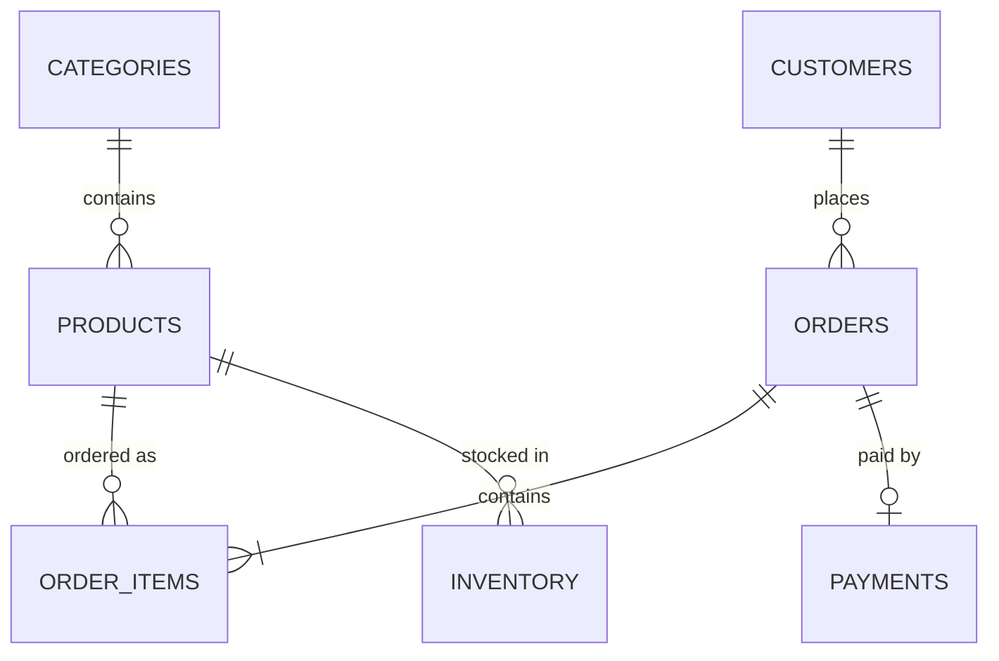
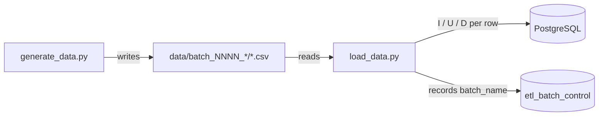

# Extensive RAG Learning Tutorials

Industry: **Retail / E-commerce**. A PostgreSQL schema plus a CDC-style data
pipeline: a generator that produces an initial full-load batch and then
incremental delta batches (inserts, updates, and a few deletes) on every
run, and a loader that applies those batches to Postgres idempotently.

DB details: `D:\GIT-CODE\git_venkata\venkatab-ai-setup\.env` (the
`venkatab-ai-onboarding.yml` Docker Compose stack in that folder brings up
the Postgres instance this pipeline targets).

## Schema



* `categories` / `products` / `customers` — soft-deleted (`is_deleted` flag) so history is preserved
* `orders` — hard-deleted; deleting an order cascades to its `order_items` and `payments`
* `inventory` — one row per `(product_id, warehouse_location)`, updated in place as stock moves

DDL: [sql/01_schema.sql](sql/01_schema.sql) · Batch tracking table: [sql/02_control_table.sql](sql/02_control_table.sql)

## Setup

```bash
pip install -r requirements.txt

# 1. Create the schema (once)
docker exec -i venkatab-ai-postgres psql -U ai_admin -d ai_setup < sql/01_schema.sql
docker exec -i venkatab-ai-postgres psql -U ai_admin -d ai_setup < sql/02_control_table.sql
```

Adjust the container name / connection details if your Postgres isn't
running via the `venkatab-ai-onboarding.yml` compose stack.

## 1. Generate data

```bash
cd generator
python generate_data.py          # first run -> initial batch (all inserts)
python generate_data.py          # every later run -> a delta batch (insert/update/delete mix)
python generate_data.py --reset  # wipe state.json and start over from an initial batch
```

Each run writes one folder under [data/](data/):
`batch_0001_initial/`, `batch_0002_delta/`, `batch_0003_delta/`, ... — one
CSV per table, with an `op` column (`I` / `U` / `D`) on every row.
Referential state (which customers/products/orders exist, and whether a
customer has orders yet) is tracked in `generator/state.json` between runs
so deltas stay consistent — e.g. only customers with **no** orders are
ever picked for deletion, and only orders reference existing customers
and products.

## 2. Load data

```bash
cd loader
python load_data.py                              # load every batch not yet applied, in order
python load_data.py --batch batch_0002_delta      # load one specific batch
python load_data.py --env-file path\to\.env       # override the default .env location
```

The loader applies each batch inside a single transaction and records it
in `etl_batch_control` on success, so re-running `load_data.py` is safe —
already-applied batches are skipped.

## Pipeline


